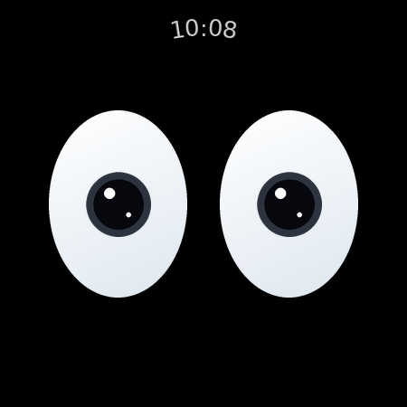
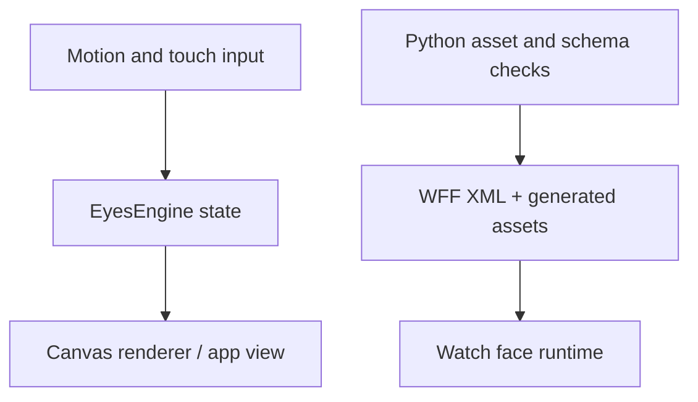

# Crazy Eyes 👀

**An interactive pair of eyes for Wear OS, with a companion watch face.**

**Source code:** [agent/watchface-labels-speed](https://github.com/luisfelipealves/crazy-eyes/tree/agent/watchface-labels-speed) · [Watch face testing](https://github.com/luisfelipealves/crazy-eyes/blob/agent/watchface-labels-speed/docs/WATCHFACE_TESTING.md)

> The watch face implementation is on the development branch. The default branch currently contains only the initial repository description.



*This is a watch-face preview asset, not a device screenshot. Physical-device captures are pending.*

## Experience

The standalone app moves the eyes with the wrist's gravity sensor (accelerometer fallback), follows a finger and reacts to taps. With no sensor input, it uses occasional random glances. The independent Watch Face Format module adds a clock, selectable eye styles and colors, animation intensity, battery-related expressions and configurable complication slots. The watch face is designed for Wear OS 4+; the app supports Wear OS 3+.

## Architecture



The app's `EyesEngine` isolates behavior from Android UI; `MotionInput` handles sensors and lifecycle; `EyesRenderer` draws the app. The `watchface/` module uses declarative Watch Face Format XML and generated assets. Python validation checks layouts and styles; Kotlin and UI tests exercise the app. The app and face are separate installable modules.

## Build and try it

Prerequisites: JDK 17, Android SDK 36 and Python with the dependencies in `tools/requirements.txt`.

```bash
git clone https://github.com/luisfelipealves/crazy-eyes.git
cd crazy-eyes
git switch agent/watchface-labels-speed
python3 -m pip install -r tools/requirements.txt
python3 -m unittest discover -s tools/tests -v
python3 -m tools.validate_watchface
./gradlew :app:testDebugUnitTest :app:assembleDebug :watchface:assembleDebug
```

App and face APKs are under their respective module `build/outputs/apk/debug/` directories. Use the [device test guide](https://github.com/luisfelipealves/crazy-eyes/blob/agent/watchface-labels-speed/docs/WATCHFACE_TESTING.md) to install and select the face.

## How we built it

I proposed the behavior, tested each APK on a Galaxy Watch and refined the experience from the observed result: touch reaction, wrist motion, clock placement, shake duration and face customization. We documented designs and plans in `docs/superpowers/`, wrote engine and asset tests, checked generated previews and validated on the device. AI-assisted implementation and review supported each iteration; the final UX decisions and physical testing were mine.

## Status and portfolio snapshot

The watch face is selectable and works on the test watch. This repository is private, so it must be made accessible before using its URL in a public CV. **Highlights:** Kotlin sensors and Canvas, Wear OS interaction design, Watch Face Format, declarative assets and human-in-the-loop testing.
